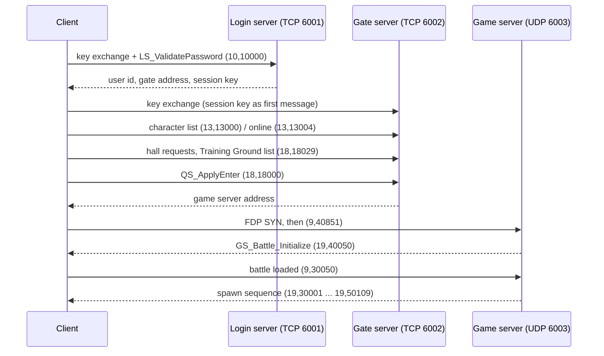

# MarsWar Protocol Docs

> Built from [index.html](index.html) by `server/tools/docs_md.py`. Edit the HTML page, then run the script; a test fails while this file is out of date.

## Contents
- [About](#intro)
- [Connection flow](#flow)
- [Data types](#types)
- [Login & gate transport](#transport)
- [Game server: FDP over UDP](#fdp)
- [Login server messages](#login-msgs)
  - [LS\_ValidatePassword](#m-10-10000) `(10,10000)`
  - [LS\_ValidatePassword reply](#m-10-10000r) `(10,10000)`
- [Gate server messages](#gate-msgs)
  - [CS\_GetCharacterList](#m-13-13000) `(13,13000)`
  - [CS\_Active\_Character](#m-13-13006) `(13,13006)`
  - [CS\_CharacterOnline](#m-13-13004) `(13,13004)`
  - [GM kick](#m-13-13041) `(13,13041)`
  - [GM banchat](#m-21-21008) `(21,21008)`
  - [GM game command](#m-9-11000) `(9,11000)`
  - [GM announce / say](#m-21-21030) `(21,21030) (21,21031)`
  - [GetShootRoomIDByCountryID](#m-18-18029) `(18,18029)`
  - [MapInfo](#m-17-17008) `(17,17008)`
  - [MapStatus](#m-18-18021) `(18,18021)`
  - [QS\_ApplyEnter](#m-18-18000) `(18,18000)`
- [Hall data](#hall-msgs)
  - [UpdateAllAnnouncement](#m-21-21047) `(21,21047)`
  - [GS\_UpdateCharacterMoney](#m-24-24019) `(24,24019)`
  - [GS\_UpdateCharacterPoint](#m-24-24020) `(24,24020)`
  - [CGS\_GetCharacterTodayMilitary](#m-14-14057) `(14,14057)`
  - [CG\_Character\_Get\_Exploit](#m-14-14010) `(14,14010)`
  - [CGS\_GetAllMilitaryRank](#m-14-14040) `(14,14040)`
  - [CGS\_UpdateAllMedalInfo](#m-14-14019) `(14,14019)`
  - [CGS\_UpdateMyMedal](#m-14-14007) `(14,14007)`
  - [CGS\_UpdateAllBadgeInfo](#m-14-14027) `(14,14027)`
  - [CGS\_UpdateMyBadge](#m-14-14028) `(14,14028)`
  - [CGS\_GetCharacterLog](#m-14-14003) `(14,14003)`
  - [CGS\_GetCharacterMilitarySuccesses](#m-14-14056) `(14,14056)`
  - [CGS\_GetCharacterbattleFrontContributionByID](#m-14-14051) `(14,14051)`
  - [CGS\_GetCharacterAllBattleFrontContribution](#m-14-14050) `(14,14050)`
  - [CS\_CharacterExpRank](#m-15-15098) `(15,15098)`
  - [CS\_OneCharacterExpRank](#m-15-15099) `(15,15099)`
  - [CS\_RankedWeaponFlyweight](#m-15-15108) `(15,15108)`
  - [CS\_CharacterWeaponRank](#m-15-15102) `(15,15102)`
- [Shop & warehouse](#shop-msgs)
  - [GS\_UpdateGoodsInSell](#m-24-24010) `(24,24010)`
  - [GS\_UpdateItemFlyweight](#m-24-24002) `(24,24002)`
  - [GS\_RequestAllGoodsFlyweight](#m-24-24008) `(24,24008)`
  - [GS\_RequestGoodsFlyweight](#m-24-24009) `(24,24009)`
  - [GS\_RequestBuyGoods](#m-24-24021) `(24,24021)`
  - [GS\_RequestMyGoods](#m-24-24011) `(24,24011)`
  - [GS\_RequestActiveGoods](#m-24-24015) `(24,24015)`
  - [GS\_RequestMyActivedGoods](#m-24-24003) `(24,24003)`
  - [GS\_UpdateItemInUse](#m-24-24006) `(24,24006)`
  - [GS\_RequestExpiredItem](#m-24-24025) `(24,24025)`
  - [GS\_SetItemInUse](#m-24-24007) `(24,24007)`
- [Talents (Robot tab)](#talent-msgs)
  - [CGS\_UpdateTalentInfo](#m-14-14042) `(14,14042)`
  - [CGS\_UpdateCharacterRemainTalentPoint](#m-14-14043) `(14,14043)`
  - [CGS\_ResetCharacterTalent](#m-14-14045) `(14,14045)`
  - [CGS\_UpdateCharacterTalentPoint](#m-14-14044) `(14,14044)`
  - [CGS\_CharacterLearnTalentCost](#m-14-14058) `(14,14058)`
  - [CGS\_CharacterLearnTalent](#m-14-14047) `(14,14047)`
- [Read from the client, not tried in game](#read-msgs)
  - [CGS\_CharacterQuickSuite](#m-14-14004) `(14,14004)`
  - [CGS\_SaveCharacterQuickSuite](#m-14-14005) `(14,14005)`
  - [GetCharacterHelpLog](#m-14-14059) `(14,14059)`
  - [UpdateTeamInfo](#m-15-15023) `(15,15023)`
  - [Task\_GetHoldTask](#m-20-20116) `(20,20116)`
  - [CS\_GetTaskServerAfficheList](#m-21-21048) `(21,21048)`
  - [GS\_RequestSuiteInSelling](#m-24-24028) `(24,24028)`
  - [Buy a package](#m-24-24029) `(24,24029)`
- [Entering a battle](#battle)
  - [first game message](#m-9-40851) `(9,40851)`
  - [GS\_Battle\_Initialize](#m-19-40050) `(19,40050)`
  - [battle loaded](#m-9-30050) `(9,30050)`
- [Multiplayer](#mp-msgs)
  - [position report](#m-9-40130) `(9,40130)`
  - [GC\_Robot\_Action](#m-9-40100) `(9,40100)`
  - [GS\_GMCommando](#m-19-31000) `(19,31000)`
  - [GS\_GMSetLocation](#m-19-33000) `(19,33000)`
- [Characters & objects](#char-msgs)
  - [GS\_Character\_New\_Character](#m-19-30001) `(19,30001)`
  - [AddToDetachment](#m-19-30500) `(19,30500)`
  - [GS\_Character\_SetControl\_Character](#m-19-30100) `(19,30100)`
  - [GS\_Object\_Attach\_Object](#m-19-50001) `(19,50001)`
  - [GS\_Character\_Set\_BaseInfo](#m-19-30040) `(19,30040)`
- [Robots & combat](#robot-msgs)
  - [use a station](#m-9-40301) `(9,40301)`
  - [ask for respawn points](#m-9-40332) `(9,40332)`
  - [pick a respawn point](#m-9-40331) `(9,40331)`
  - [Respawn in the Robot Roof](#m-9-40310) `(9,40310)`
  - [quick respawn from the death dialog](#m-9-40335) `(9,40335)`
  - [Robot Roof stock, several Types](#m-9-40311) `(9,40311)`
  - [cancel an order](#m-9-40314) `(9,40314)`
  - [big map status](#m-9-40333) `(9,40333)`
  - [Robot Roof stock](#m-9-40312) `(9,40312)`
  - [GS\_Object\_Detach\_Object](#m-19-50002) `(19,50002)`
  - [GS\_Character\_Delete\_Character](#m-19-30002) `(19,30002)`
  - [GS\_Robot\_Skill](#m-19-50132) `(19,50132)`
  - [GS\_Robot\_Action (move)](#m-19-50100) `(19,50100)`
  - [GS\_Robot\_SystemPart (rebuild)](#m-19-50104) `(19,50104)`
  - [GS\_Robot\_SystemPart (switch weapon)](#m-19-50105) `(19,50105)`
  - [GS\_Robot\_SystemPart (shot)](#m-19-50122) `(19,50122)`
  - [GS\_Object\_Armor](#m-19-50005) `(19,50005)`
  - [GS\_Robot\_Survival (dead)](#m-19-50107) `(19,50107)`
  - [GS\_Robot\_Survival (relive)](#m-19-50108) `(19,50108)`
  - [GS\_Robot\_Survival (revived)](#m-19-50109) `(19,50109)`
  - [GS\_Robot\_Malice (honor)](#m-19-50130) `(19,50130)`
  - [GS\_Robot\_Malice (kill report)](#m-19-50151) `(19,50151)`
  - [GS\_UpdateKillInfo](#m-19-30204) `(19,30204)`
  - [GS\_Character\_Wage](#m-19-30201) `(19,30201)`
- [Client reports](#client-msgs)
  - [switch weapon request](#m-9-40105) `(9,40105)`
  - [trigger pulled](#m-9-40122) `(9,40122)`
  - [trigger released](#m-9-40125) `(9,40125)`
  - [robot move](#m-9-40100) `(9,40100)`
  - [position](#m-9-40130) `(9,40130)`
  - [position + facing](#m-9-40133) `(9,40133)`
  - [robot action](#m-9-40101) `(9,40101)`
  - [clock](#m-9-20001) `(9,20001)`
  - [ping](#m-9-9001) `(9,9001)`
- [Rounds](#rounds)
  - [DisconnectByServer](#m-19-30150) `(19,30150)`
  - [GS\_Character\_Show\_Message](#m-19-30250) `(19,30250)`
  - [Arena\_KILL\_Waiting\_Begin](#m-19-49000) `(19,49000)`
  - [Arena\_KILL\_SetScore](#m-19-52001) `(19,52001)`
  - [Arena\_KILL\_Score](#m-20-20130) `(20,20130)`
- [Chat](#chat)
  - [Chat\_BigBugleSendMessage](#m-21-21513) `(21,21513)`
  - [whisper](#m-21-21051) `(21,21051)`
  - [chat channel](#m-21-21004) `(21,21004)`
  - [CHAT\_GetFriendListFormDB](#m-21-21522) `(21,21522)`
  - [CHAT\_AddFriendListFormDB](#m-21-21524) `(21,21524)`
  - [CHAT\_DelFriendListFormDB](#m-21-21525) `(21,21525)`
- [Snapshots](#snapshots)
- [Tools & method](#tools)

<a name="intro"></a>

## About

Protocol notes for MarsWar (Welkin4591), a TK Digital mech shooter. The servers are gone. These notes come from the 2010 Windows client and were tested against our own server emulator.

Every message has a **catalog** (u8) and a **type** (u16), written here as `(catalog, type)`. Names come from the client's own handler classes. Offsets like `+0xfc` say where a value is stored in the client, to help when reading the disassembly.

- C→S sent by the client
- S→C sent by the server
- Status: **verified** = works in the emulator · **partial** = fields still unknown · **read, not tried** = read from the client, not yet seen working in it

<a name="flow"></a>

## Connection flow

The client talks to three servers. Each one hands over the address of the next.



The login and gate servers share one transport (below). The game server uses a reliable-UDP layer called FDP. The client also probes an "ADServer" on UDP 5876 for NAT detection; it needs no answer.

One program can be all three servers, or they can run separately. The client can not tell. When they are separate, login signs the session key with Ed25519 and a gate holds only the public key, so the key is about 170 characters. Each key works once. The battle ticket is a u32 and can not be signed, so the gate tells the game server about it first. The servers talk to each other on private links, which are not part of the game protocol.

Server addresses come from `game_client_config.xml` (`LoginServer`, `ADServer`). `Loader.exe` is a dead auto-updater; start `System\MarsWar.exe` directly.

<a name="types"></a>

## Data types

| Name | Size | Meaning |
|---|---|---|
| u8 / u16 / u32 | 1 / 2 / 4 | Unsigned little-endian integers. `i32` is signed. |
| f32 / f64 | 4 / 8 | IEEE floats, little-endian. |
| vec3 | 12 | Three f32: x, y, z. Y is up. |
| str | var | 7-bit varint byte length (.NET `BinaryWriter` style) followed by UTF-8 text. Used almost everywhere. |
| str8 | var | u8 length + Latin-1 bytes. Only seen in the login request. |

<a name="transport"></a>

## Login & gate transport

<a name="kx"></a>
### Key exchange

Each TCP connection opens with a plain frame `"0001" | u32 length | rest`. The client sends a fresh RSA-512 key; the server answers with an AES key encrypted to it.

#### KX request

*C→S · verified*

| Field | Type | Notes |
|---|---|---|
| magic | "0001" | ASCII |
| length | u32 | bytes that follow |
| status | u32 | 1 |
| — | u32 | 0 |
| — | u32 | 9 |
| key length | u32 | 0x5c |
| public key | bytes | X.509 DER RSA-512, e = 17, new for every connection |
| first message | bytes | On the gate: `str` session key from the login reply, a space, and a machine hash |

#### KX reply

*S→C · verified*

| Field | Type | Notes |
|---|---|---|
| magic | "0001" |  |
| length | u32 |  |
| status | u32 | 1 |
| key block | bytes | RSAES-OAEP-SHA1 of `i32 key_index (1..32) \| u16 0 \| 16-byte AES key` |

<a name="packets"></a>
### Packets

```text
u8 flags | length (1, 2 or 4 bytes) | AES-128-ECB payload | u8 checksum
```

- **flags**: bits 6–7 give the width of the length field (1 = u8, 2 = u16, 3 = u32); bit 0 marks a system packet. Bit 1 is *not* an encryption flag: every packet is encrypted.
- **length** counts the payload plus the checksum byte.
- **payload**: AES-128-ECB with the exchanged key. The last plaintext byte is the pad count (1–16).
- **checksum** = (sum of header bytes + sum of `payload[::key_index]`) mod 256.

<a name="message"></a>
### Message header

The decrypted payload is one `Outpop::Message` (MessageService.dll):

```text
u8 flags | u8 catalog | [u16 type] | [u32 token] | [u16 result] | [u32 multi id] | body
```

| Flag | Bit | Adds |
|---|---|---|
| has type | 0x80 | u16 type |
| request | 0x04 | u32 token (echoed in the reply) |
| ack | 0x08 | u32 token + u16 result (0 = success) |
| multicast | 0x20 / 0x40 | u32 multi id |
| trans | 0x02 | — |

> If a request gets no reply, the UI waits forever. The emulator answers unknown requests with success and 32 zero bytes (empty lists, zeros, empty strings). This works almost everywhere. Exception: `(14,14057)` TodayMilitary crashes the client with a zeroed reply.

<a name="fdp"></a>

## Game server: FDP over UDP

FDP is the client's reliable-UDP session layer (IONetwork.dll `Dgram_*` / `Session_Holder`). Its payloads are plaintext, with no AES.

```text
u8 flags | u16 number | u16 session | u16 mtu length | u8 split id | u16 ack id | u16 order id   (12 bytes)
```

| Packet | Flags | Fields |
|---|---|---|
| SYN | 0x07 | split 2, session = client session id, payload `u32 n \| n bytes` connect stream. Resent every 3 s. |
| SYN-ACK | 0x07 | split 3, mtu length 12, ack id = server session id, order 1 (2 = no session, 3 = session mismatch). After this every packet carries the *receiver's* session id. |
| close | 0x07 | split 4. The client sends this when it leaves a battle. |
| ack | 0x05 | split 1, number = sender's next reliable number, ack id = next number expected (cumulative), order 2. |
| reliable data | 0xe1 | split 1. Order id must increase by one per packet; a repeated order id is silently dropped. |
| unreliable data | 0x01 / 0x21 | own number counter, order 0 |

A data payload holds one or more messages, each `u16 length | Outpop::Message`. Reliable and unreliable packets keep separate sequence counters.

<a name="envelope"></a>
### Event envelope

Every message the game server sends starts with this envelope:

```text
f32 event time (0 = now; non-zero schedules it later) | u32 unique key (duplicates dropped) | payload
```

> Send game events on **catalog 19**. The client ignores catalog 9 messages from the server (it treats them as outgoing). Catalog 19 events belong to the local player's character automatically.

<a name="login-msgs"></a>

## Login server messages

<a name="m-10-10000"></a>
#### LS\_ValidatePassword `(10,10000)`

*C→S · verified*

| Field | Type | Notes |
|---|---|---|
| version | u32 |  |
| account | str8 |  |
| password | str8 | plain text inside the AES channel |
| region | u32 | 10102 |
| — | u32 | 1 |
| machine hash | str8 |  |

<a name="m-10-10000r"></a>
#### LS\_ValidatePassword reply `(10,10000)`

*S→C · verified*

| Field | Type | Notes |
|---|---|---|
| user id | u32 |  |
| gate ip | u32 | network order as packed by the server |
| gate port | u16 | 6002 |
| session key | str | sent back to the gate as the KX first message |
| — | 8 + 4 bytes | zero |
| ip2 | u32 |  |
| flag | u8 |  |

<a name="gate-msgs"></a>

## Gate server messages

All gate requests carry a token; replies echo it with result 0.

<a name="m-13-13000"></a>
#### CS\_GetCharacterList `(13,13000)`

*S→C reply · verified*

```text
u32 count | count x ( u32 id | str name | u8 | u32 nation | u8 | u8 state )
```

Count 0 opens nation select and character creation. State 2, 4 or 8 reopens nation select; anything else makes the client send CS\_CharacterOnline.

<a name="m-13-13006"></a>
#### CS\_Active\_Character `(13,13006)`

*C→S · partial*

Create a character. Request, from `CCreateCharacterUI::ClickConfirm` and seen from the real client: `str name | str (empty) | u32 nation | u32 0 | u8 0 | u32 gender (1 or 2)`. The nation is the side picked on the Choose Nation screen before: 0x10 Federal, 0x20 Alliance (`NATION_TYPE`). The emulator keeps it in the column it calls `model`. Reply: `u32 new character id`; the client then asks for the list again.

<a name="m-13-13004"></a>
#### CS\_CharacterOnline `(13,13004)`

*S→C reply · partial*

```text
u32 id | u8 nation | u32 | u32 | u8 GM level | str name | str | u8 | u8 | u32 | str | str | str | u32 n | n x (u32 | u16 | u8 | u8)
```

Builds the hall (`CNewHallUI`). The byte after the id is the character's nation (character +0x30). Real client 2026-11-04: with 0x20 the hall shows the Alliance emblem before the name instead of a star, and the name under "My Ranking" turns red.

<a name="m-13-13041"></a>
#### GM kick `(13,13041)`

*C→S request · read, not tried*

```text
u32 character id | str name | u32 number
```

The client's own `/kick <name> <number>`. Its chat box has GM commands when the GM level in CharacterOnline is 101 to 110 (local character +0xb8): kick, announce, say, tell (the normal whisper), banchat, hideme, damage and moveto go to the server; god and godspeed only change the GM's own client. The ack has no body: result 0 shows "Kick %s Success!", anything else "Kick %s Failed!". What the number means is not known. They work in the battle chat box only; the hall's Lobby box sends a normal line. The emulator sends GM level 101 for the gm role and 110 for admin, and runs the same kick as `!kick`.

<a name="m-21-21008"></a>
#### GM banchat `(21,21008)`

*C→S · read, not tried*

```text
u32 character id | str name (only when the id is 0) | u32 seconds
```

`/banchat <id> [<name>] <minutes>`; the client sends minutes x 60. The emulator runs it as `!mute` (0 minutes: `!unmute`). A muted character's lines are not sent, and they are told until when.

<a name="m-9-11000"></a>
#### GM game command `(9,11000)`

*C→S game · read, not tried*

```text
u32 command | u32 value, or str name for moveto
```

The GM commands that go to the game server, numbered as in the client's list: 7 `/hideme <n>`, 8 `/damage <n>`, 11 `/moveto <character>`. The emulator moves the GM next to that player with GS\_GMSetLocation, and only logs 7 and 8.

<a name="m-21-21030"></a>
#### GM announce / say `(21,21030) (21,21031)`

*C→S · read, not tried*

```text
21030: u16 kind | u32 | str text    21031: u16 kind | u32 | u32 | str text
```

`/announce <kind> [<number> when kind is 1] <text>` and `/say <kind> <number> [<number> when kind is 2] <text>`. What the kinds and numbers mean is not known; the emulator sends the text as a notice (`!notice`, admins only). The client reads the text with `>>`, so only its first word is sent (real client 2026-11-05).

<a name="m-18-18029"></a>
#### GetShootRoomIDByCountryID `(18,18029)`

*S→C reply · verified*

```text
u32 count | count x ( u32 battlefield id | u32 | str name )
```

The Training Ground list, polled every 10 s. For each id the client also requests MapInfo and MapStatus.

<a name="m-17-17008"></a>
#### MapInfo `(17,17008)`

*S→C reply · verified*

```text
u32 id | str name | str desc | 4 x u8 | u8 type | 4 x u32 | str world file ("Atrain01.reb") | 3 x f32 | str
```

The first two u32 are the big map's picture size (BATTLE\_FIELD\_INFO +0x64 / +0x68, used by CRadarMapUI::ChangeMap): the size of Maps\&lt;name>\&lt;name>.bmp, 512 × 512 for Atrain01 and 1024 × 1024 for B01. With 0 × 0 the big map (M) does not open and the death map's icons all sit in one corner. Real client 2026-11-06.

<a name="m-18-18021"></a>
#### MapStatus `(18,18021)`

*S→C reply · verified*

```text
u32 status | u32 count | count x ( u8 nation | u32 value )
```

<a name="m-18-18000"></a>
#### QS\_ApplyEnter `(18,18000)`

*C→S · verified*

Request: `u32 character id | u32 battlefield id | u32 | u16`.

```text
reply: u32 1 | u32 game server ip | u16 game server port | u32 ticket
```

The first u32 must be 1 or the client never connects. The client sends the ticket back as the first (and third) u32 of its FDP connect stream, so the game server knows which character a connection belongs to. The emulator issues a random single-use ticket per Quick Enter.

<a name="hall-msgs"></a>

## Hall data

> A reply that is too short or malformed shows a popup reading "Waiting to enter arena." That is the English text for `GAMEENGINE_DATAUNNORMAL` (bad data), not an arena queue.

Requests the hall sends after login. All are gate requests with a token; the reply echoes it.

<a name="m-21-21047"></a>
#### UpdateAllAnnouncement `(21,21047)`

*S→C reply · verified*

```text
u32 count | count x ( u32 id | str text | u32 )
```

Lines for the hall's scrolling announcement bar. A second observer (0x10590dd0) also empties the New Lobby's scrolling text and its GM lines in chat, then gives each row to CChatMessageUI::AddGMHallAnnounce(id, text, last u32) and CNewHallUI::AddBroadcast(text, last u32, id).

<a name="m-24-24019"></a>
#### GS\_UpdateCharacterMoney `(24,24019)`

*S→C reply · verified*

Request: `u32 character id`. Reply: `u32 money`, shown as Crystal in the shop.

<a name="m-24-24020"></a>
#### GS\_UpdateCharacterPoint `(24,24020)`

*S→C reply · verified*

Request: `u32 character id`. Reply: `u32 points`, shown as Credit in the shop.

<a name="m-14-14057"></a>
#### CGS\_GetCharacterTodayMilitary `(14,14057)`

*S→C reply · verified*

```text
u32 battlefield time (s) | u32 kills | u32 deaths | u32 honor | u32 crystal
| u32 arena time (s) | u32 kills | u32 deaths | u32 honor | u32 crystal
```

The Battle Report panel. Honor and crystal are shown as battlefield + arena. A reply shorter than 40 bytes crashes the client.

<a name="m-14-14010"></a>
#### CG\_Character\_Get\_Exploit `(14,14010)`

*S→C reply · partial*

```text
u32 exploit | 4 x u32 | u8 | u32
```

Rank experience, shown as "exploit / next rank".

<a name="m-14-14040"></a>
#### CGS\_GetAllMilitaryRank `(14,14040)`

*S→C reply · verified*

```text
u32 count | count x ( u8 level | str name | u32 exploit needed )
```

Rank names come from the client (ENG.xml `CHARACTER_EXPLOIT0`–`70`, Recruit to Marshal). The rank level itself is the u8 after the two strings in the CS\_CharacterOnline descriptor. Recruits only see the Training Ground; higher ranks unlock Grand Battle Field, Arena and Division.

> The last u8 of the login reply is an "ID verified" flag. 0 shows the anti-addiction banner in the hall.

<a name="m-14-14019"></a>
#### CGS\_UpdateAllMedalInfo `(14,14019)`

*S→C reply · verified*

```text
u32 count | count x ( u16 medal id | str name | str description )
```

Icons ship with the client: `icon_medal_<id>.dds` for 10101–10503.

<a name="m-14-14007"></a>
#### CGS\_UpdateMyMedal `(14,14007)`

*S→C reply · verified*

Request: `u32 character id`.

```text
u32 count | count x u16 medal id
```

<a name="m-14-14027"></a>
#### CGS\_UpdateAllBadgeInfo `(14,14027)`

*S→C reply · verified*

```text
u32 count | count x ( u16 badge id | str name | str text | u8 grade )
```

One entry per grade (1–3). The client puts Bronze / Silver / Gold straight in front of the name, so start the name with a space. Icons: `icon_badge_<id>_<grade>.dds`.

<a name="m-14-14028"></a>
#### CGS\_UpdateMyBadge `(14,14028)`

*S→C reply · verified*

Request: `u32 character id`. When the Info window asks, the reply is read as:

```text
u32 count | count x ( u16 badge id | u8 grade | u32 progress )
```

A shorter `(u16 id | u8 grade)` layout also exists in the client (CGS\_UpdateMyBadgeObserver), but the Info window throws on it.

<a name="m-14-14003"></a>
#### CGS\_GetCharacterLog `(14,14003)`

*S→C reply · verified*

Request: `u32 character id | u8 | u32 page | u32 per page` (seen 0, 1, 50). The Event Log tab.

```text
u32 total | u32 count | count x (
  u32 id | u8 kind | str text | str time | 6 x u32 )
```

Each line shows as "time - text", newest first. The tab has Previous 50 / Next 50 buttons.

<a name="m-14-14056"></a>
#### CGS\_GetCharacterMilitarySuccesses `(14,14056)`

*S→C reply · verified*

Request: `u32 character id | u8 kind` (1 battlefield, 2 arena). The Battle tab in the Info window.

```text
u32 battle time (s) | u32 victories | u32 kills | u32 deaths | u32 vehicles destroyed
```

<a name="m-14-14051"></a>
#### CGS\_GetCharacterbattleFrontContributionByID `(14,14051)`

*S→C reply · verified*

Request: `u32 character id | u32 battlefront id`. Reply: `u32 contribution`. Shown in the Total Contribution column of the Grand Battle Field list and under Battle Joined. The emulator counts honor from kills on that front.

<a name="m-14-14050"></a>
#### CGS\_GetCharacterAllBattleFrontContribution `(14,14050)`

*S→C reply · read, not tried*

Request: `u32 character id`.

```text
u32 count | count x ( u32 battlefront id | u32 contribution )
```

<a name="m-15-15098"></a>
#### CS\_CharacterExpRank `(15,15098)`

*S→C reply · verified*

The Ranking window's Honor tab. Shooting is (15,15100) and Crystal is (15,15106), same layout. Request: `u8 period | u32 first row | u32 rows`; Shooting has a u8 1 after the period. Period 1 Total, 2 Monthly, 3 Weekly, 4 Daily; the client asks for 20 rows and has no paging. For a period the emulator lists what was earned in it (honor, kills, crystal earned), and only characters who earned something.

```text
u32 total | u32 count | count x (
  u32 character id | str name | u8 nation | u32 team
  | str | u8 rank level | u32 score )
```

The client numbers the rows itself and highlights the row whose id is your character. Nation 0x10 (Federal) draws the name green, 0x20 (Alliance) red, anything else almost black. The second string is read and thrown away; the u32 after the camp is a team id: if it is not 0 the client asks (15,15023) UpdateTeamInfo for it, once per row.

<a name="m-15-15099"></a>
#### CS\_OneCharacterExpRank `(15,15099)`

*S→C reply · verified*

Request: `u32 character id | u8 period`. Also (15,15101) and (15,15107) for the other tabs; Shooting's (15,15101) has a u8 1 at the end.

```text
u32 place counted from 0 | u32 score
```

Shown as "My Ranking" under the list only when the place is past 18 (seen in game at place 26); otherwise your row in the list is highlighted.

<a name="m-15-15108"></a>
#### CS\_RankedWeaponFlyweight `(15,15108)`

*S→C reply · verified*

The Ranking window's Weapon and Vehicle tab buttons. Request: `u32` (0).

```text
u32 count | count x ( u32 kind | u32 weapon id | str name )
```

Kind 1 makes a Weapon tab button, any other kind a Vehicle tab button.

<a name="m-15-15102"></a>
#### CS\_CharacterWeaponRank `(15,15102)`

*S→C reply · verified*

One weapon's list, same layout as (15,15098). Request: `u8 period | u32 kind | u32 weapon id | u32 first row | u32 rows`, kind as in (15,15108). My place is (15,15103): request `u32 character id | u8 period | u32 kind | u32 weapon id`, reply `u32 place | u32 score`. The emulator's score is kills made with that weapon.

<a name="shop-msgs"></a>

## Shop & warehouse

The shop sells *goods*. Each goods has an *item* (the product, same id as its weapon or equipment flyweight, e.g. 3101 Viper) and a picture `GoodsPic_<item>.dds` that ships with the client. Bought goods sit in the warehouse until the player clicks Apply, which starts the rental time.

<a name="m-24-24010"></a>
#### GS\_UpdateGoodsInSell `(24,24010)`

*S→C reply · verified*

Request: `u32 | u32 | u32` (seen 2, 1, 0x7fffffff).

```text
u32 | u32 count | count x (
  u32 goods id | str | str | str | u8
  | u32 picture id | u32 item id | u32 credit price | u32
  | u32 crystal price (-1 = not sold for crystal) | u32 | u32 uses
  | u32 minutes (over 1000000 = forever) | u8 filter )
```

The filter byte picks the list: 1 = Crystal, 2 = Credit. Items show up after a filter is clicked.

<a name="m-24-24002"></a>
#### GS\_UpdateItemFlyweight `(24,24002)`

*S→C reply · verified*

Request: `u32 item id`. The shop asks once per item it shows.

```text
str name | u8 | u8 | u8 price kind | str | u32 picture id | u32
```

Price kind must be 2 (rented by days). Other kinds print "per use" prices with `GUITEXT_MARKET_*_TIMES_TEMPLATE`, which is `%dCrystal(%s)` in ENG.xml. The client passes a number for the `%s` and crashes.

<a name="m-24-24008"></a>
#### GS\_RequestAllGoodsFlyweight `(24,24008)`

*S→C reply · verified*

```text
u32 count | count x ( u32 goods id | goods record )
```

<a name="m-24-24009"></a>
#### GS\_RequestGoodsFlyweight `(24,24009)`

*S→C reply · verified*

Request: `u32 goods id`. Reply: one goods record.

```text
goods record = str name | u32 item id | u8 | str | str | u8 | u32 | u32 | u32 picture id | u32
```

<a name="m-24-24021"></a>
#### GS\_RequestBuyGoods `(24,24021)`

*C→S · verified*

```text
u32 character id | u8 | u8 | u32 goods id
```

The reply has no body. Result 0 = bought; the client then asks for money (24019) and items again. Any other result shows that error text.

<a name="m-24-24011"></a>
#### GS\_RequestMyGoods `(24,24011)`

*S→C reply · verified*

Request: `u32 character id | u8 | u32 | u32`.

```text
u32 | u32 count | count x ( u32 instance id | u32 goods id )
```

Bought goods not applied yet (warehouse "Not Activated").

<a name="m-24-24015"></a>
#### GS\_RequestActiveGoods `(24,24015)`

*C→S · verified*

```text
u32 character id | u32 instance id
```

The Apply button. The reply has no body.

<a name="m-24-24003"></a>
#### GS\_RequestMyActivedGoods `(24,24003)`

*S→C reply · verified*

```text
u32 | u32 count | count x ( u32 item id | u32 instance id | str expiry date | u8 1 )
```

Applied goods. The client cuts the date at the first `:`, so send just the date. Empty date = forever. Last byte 0 marks the item expired.

<a name="m-24-24006"></a>
#### GS\_UpdateItemInUse `(24,24006)`

*S→C reply · partial*

```text
u32 slots | u32 count | count x ( u32 slot | u32 item id | u8 | u32 minutes left | str )
```

Items listed here count as equipped and are hidden from the warehouse. Slots is the number of in-use slots; slot is 1-based. The client keeps a list of that many entries (character +0x3e4) and puts slot i's picture on Warehouse control 16 + i. The hall Warehouse (dialog 109) has 10 cells under "Equipped PlugIn", controls 17 to 26, so the emulator sends 10: a higher slot would land on the controls after them.

> The emulator gives the player the weapon in the lowest in-use slot in battle, else the newest applied weapon. The weapon flyweight id is the item id.

<a name="m-24-24025"></a>
#### GS\_RequestExpiredItem `(24,24025)`

*S→C reply · partial*

```text
u32 n | n x ( u32 item id | u8 )
```

Read from Game.dll, not tried in game. Request: `u32 character id | u8`, sent by the Warehouse when it shows expired items. The client empties its expired list and adds each item id. The u8 is not known (the emulator sends 0). The observer for (24,24026) GS\_RequestRemoveExpiredItem is registered, but nothing in Game.dll sends that request.

<a name="m-24-24007"></a>
#### GS\_SetItemInUse `(24,24007)`

*C→S · partial*

```text
u32 character id | u32 item id | u32 slot
```

Read from Game.dll, not tried in game. Sent when an item is dropped in the hall Warehouse: on a slot (1-based), or with slot 0 when an in-use item is dropped back on the list. The reply has no body; on result 0 the client puts the item in the slot itself, or takes it out. The emulator keeps the slot with the item and refuses items that are not activated, expired or not the player's.

<a name="talent-msgs"></a>

## Talents (Robot tab)

Each talent is a robot type. The tooltip (skills, armor, type) comes from the robot's own flyweight in the client. Locked talents show "need &lt;rank>".

<a name="m-14-14042"></a>
#### CGS\_UpdateTalentInfo `(14,14042)`

*S→C reply · verified*

Request: `u8` (seen 1, probably the nation).

```text
u32 count | count x (
  u32 talent id | str name | u8 max level | u8
  | u8 column (0 Battle, 1 Engineer, 2 Scout) | u8 rank needed | u8 row | u8 1
  | u32 robot flyweight (e.g. 1311 Walker_Basic) )
```

<a name="m-14-14043"></a>
#### CGS\_UpdateCharacterRemainTalentPoint `(14,14043)`

*S→C reply · verified*

Request: `u32 character id`.

```text
u32 total points | u32 remaining points | str last forget time "Y-M-D h:m:s"
| u32 minutes before forgetting again | u32 forget price (crystal)
```

Remaining 0 hides the upgrade buttons. The Forget Talent button shows the price in its confirm box. If the wait is not over, it shows the last time and how long is left instead, so send a date even if the player never forgot (the emulator sends 2000-01-01 00:00:00).

<a name="m-14-14045"></a>
#### CGS\_ResetCharacterTalent `(14,14045)`

*C→S · verified*

```text
u32 character id
```

Forget Talent, after the confirm box. The reply has no body; the client then clears the talents and asks for 14044 and 14043 again. Any other result shows that error text: the emulator uses 14005 (no talents), 14003 (too soon) and 24010 (not enough crystal), and checks price and wait itself.

<a name="m-14-14044"></a>
#### CGS\_UpdateCharacterTalentPoint `(14,14044)`

*S→C reply · verified*

Request: `u32 character id`.

```text
u32 count | count x ( u32 talent id | u8 level )
```

<a name="m-14-14058"></a>
#### CGS\_CharacterLearnTalentCost `(14,14058)`

*S→C reply · verified*

```text
u32 count | count x ( u32 talent id | u32 levels | levels x u32 points )
```

<a name="m-14-14047"></a>
#### CGS\_CharacterLearnTalent `(14,14047)`

*C→S · verified*

```text
u32 character id | u32 talent id
```

The upgrade button. Reply: `u32 remaining points`. The client adds the level itself. An empty reply shows the bad-data popup.

<a name="read-msgs"></a>

## Read from the client, not tried in game

Reply layouts read from the observers in Game.dll. A read past the end of a reply is skipped and leaves the old value (often stack junk), so a list reply should always carry its count.

<a name="m-14-14004"></a>
#### CGS\_CharacterQuickSuite `(14,14004)`

*S→C reply · partial*

```text
u32 n | n x ( u32 preset id | str text )
```

Request: `u32 character id | u8`. Loadout presets of the Robot Roof (the respawn screen in battle, dialog 108). Real client: presets sent in the hall were parsed, but the battle screen did not show them. The client parses the text itself, space separated: `name a b c d k <k numbers> m <m numbers>` (meaning of the numbers not known; names cannot hold spaces). The emulator sends back what 14005 saved.

<a name="m-14-14005"></a>
#### CGS\_SaveCharacterQuickSuite `(14,14005)`

*C→S · partial*

```text
u32 preset id | str text
```

Sent from Game.dll 0x106afdb0, text as in 14004. The ack has no body; any other result shows ROBOTROOFUI\_QUICKSUITESAVE\_FAILED. The emulator keeps 10 presets of up to 400 plain characters.

<a name="m-14-14059"></a>
#### GetCharacterHelpLog `(14,14059)`

*S→C reply · partial*

```text
str log | u8 flag
```

Help events already seen, each id followed by `|`: `10100|10101|`. A log starting with `|` or holding `||` hangs the client. With 10100 missing and rank level (+0x44) 1, the client opens the tutorial video. Nothing in Game.dll sends the save request (14,14060), so the emulator answers with an empty log.

<a name="m-15-15023"></a>
#### UpdateTeamInfo `(15,15023)`

*S→C reply · partial*

```text
str name | u32 | u8 | u8 | u8 | str | str | u32 | str | u32 | u32 | str
| str | u32 | u32 | u32 | u32 | u32 | u32
```

Request: `u32 team id`. At least 49 bytes. Fills the team name cache, and the player's own team when the id is theirs. Asked for any nonzero team id in ranking rows, so those send 0.

<a name="m-20-20116"></a>
#### Task\_GetHoldTask `(20,20116)`

*S→C reply · partial*

```text
u32 n | n x ( str token | str name | str info | u32 type | u32 mode | i32 time
| 3 x u32 position | u32 target | str | u32 battlefield | str | u32 accepter | str
| u32 bound object | str | u32 template | u32 level )
```

Held missions. A body under 4 bytes reads the count from stack junk and loops on huge allocations: always send the count.

<a name="m-21-21048"></a>
#### CS\_GetTaskServerAfficheList `(21,21048)`

*S→C reply · partial*

```text
u32 n | n x ( str text | u32 seconds )
```

Asked once at hall login, from the CharacterOnline reply. Each line goes to CNewHallUI::AddBroadcast(text, u32, 0), the New Lobby's (dialog 0x71) scrolling text; the u32 becomes the float CScrollingText::AddText keeps next to the time the line was added, so it is probably seconds. The emulator gives the default empty list.

<a name="m-24-24028"></a>
#### GS\_RequestSuiteInSelling `(24,24028)`

*S→C reply · partial*

```text
u32 (not read) | u32 n | n x ( u32 id | str name | str contents | u32 picture | u32 item id
| u32 point price | u32 | u32 money price | u32 )
```

Shop Package tab. Picture GoodsPic\_&lt;picture>.dds; the client has 9000 to 9006, gift boxes with the package's name on them (Infantry 30Days, Ultimate, Almighty, Infantry Weapon, Infantry Gear, Ground Vehicle, Air Vehicle). The item id must be one the client knows (asked with (24,24002)), or the package is left out. Money (Crystal) price -1 shows the point (Credit) price instead. The buy dialog shows the name and contents strings. Request: `u32 0xffff | u32 1`. The emulator uses the picture number as package id and item id; the contents are its own. Real client 2026-11-05: the tab shows the packages from the second time it is opened (the first time it still shows the License goods).

<a name="m-24-24029"></a>
#### Buy a package `(24,24029)`

*C→S · partial*

```text
u32 character id | u8 currency | u32 package id
```

Real client 2026-11-05: bought, the price came off and the items showed in the Warehouse. Currency 1 = Crystal, else Credit. The reply has no body. On result 0 the client asks for its Crystal (24019) or Credit (24020) and the in-use list (24006) again and shows dialog 0x6b; any other result shows that error text. The emulator puts each item of the package in the warehouse, as if bought one by one.

Also read, all safe with an empty list: (14,14034) `u32 n | n x (u8 rank | u32)` in the own-corps window; (14,14054) `u32 n | n x (u8 grade | u32)`; (15,15022) corps name and details for a corps id; (15,15074) `u32 n | n x (u32 team | str | str | str flag | u8)`; (15,15093) `u32 n | n x (u32 | u32)`; (17,17079) `u32 0` = no headquarters; (17,17099) `u32 n | n x city link`; (13,13047) and (21,21069) read one u32 and drop it; (17,17111) request `u32 battle front id`, reply `str | str | u8`, the first str stored for that front in the hall's joined battle list.

<a name="battle"></a>

## Entering a battle

<a name="m-9-40851"></a>
#### first game message `(9,40851)`

*C→S · partial*

First message after the FDP session opens. The server answers with GS\_Battle\_Initialize.

<a name="m-19-40050"></a>
#### GS\_Battle\_Initialize `(19,40050)`

*S→C · verified*

```text
u32 map id | str world file | u8 | u32 n | n x preload (3 x str) | u32 m | m x (3 x u32) | u32 arena logic [logic data]
```

Arena logic: 0 none, 1 Big (normal battlefield), 2 GrabMoney, 3 OD, 4 EM, 5 Kill. The client loads the world and shows "Battle initialize success."

<a name="m-9-30050"></a>
#### battle loaded `(9,30050)`

*C→S · verified*

Body `u32 0`, followed by `(9,10006)` `u32 0 | f32 1.0`. This is the cue to spawn the player.

### Spawn sequence

1. [(19,30001)](#m-19-30001) new character
2. [(19,30500)](#m-19-30500) add to a detachment (robot setup crashes without one)
3. [(19,30100)](#m-19-30100) set control: before the robot exists, so the robot is created as local
4. [(19,50001)](#m-19-50001) attach the robot object with its snapshot
5. [(19,30100)](#m-19-30100) set control again so the camera attaches
6. [(19,30040)](#m-19-30040) base info: name and robot id
7. [(19,50105)](#m-19-50105) take up weapon slot 1
8. [(19,50109)](#m-19-50109) revived: switches to first-person view

<a name="mp-msgs"></a>

## Multiplayer

Everyone on one battlefield shares a match. Each client is told about the others' robots the same way as the dummies (New\_Character, AddToDetachment, Attach\_Object, BaseInfo, then Relive and a parts rebuild). Then the server relays:

<a name="m-9-40130"></a>
#### position report `(9,40130)`

*C→S · verified*

```text
u32 | vec3 position
```

Sent several times a second. Relayed to the other players as GS\_Robot\_Action (19,50100).

<a name="m-9-40100"></a>
#### GC\_Robot\_Action `(9,40100)`

*C→S · partial*

```text
f32 time | u32 key | vec3 position | vec3 facing
```

Sent now and then; the facing is used for the relayed moves.

Shots: on a trigger pull (9,40122) the server plays the burst on the other clients with the remote-shot event (19,50122), one shot per fire interval until the release (9,40125). Hits on players use the same server-side hit test as the dummies; the armor update (19,50005), death (19,50107) and kill report (19,50151) go to everyone. A hill between the muzzle and the robot stops a shot: the server reads each map's ground heights from `Maps/<map>/Terrain01.hmd`, `u32 columns | u32 rows | rows x columns f32`, one height every 10 map units along x (columns) and z (rows), centered on 0,0 (the client's terrain mesh tiles hold the same heights). Buildings and rocks stop shots too. The map's `.reb` is a list of objects, each `str name | u32 | 16 f32 world matrix (rows; position in the last row) | 16 bytes id | str class | u32 n | n x (str name | u32 type | value)`, strings being `u32 length | text, NUL and one more byte` and types 1 u8, 2 i32, 3 f32, 5 vec3, 0x0b str, 0x0c 16 bytes. Solid objects are `PrefabInstance`s with `CollidesRays` 1 and `GhostObject` 0; their `ModelFilename`'s collision mesh is `<model>.reb.240physx`, a PhysX cooked mesh: `"NXS" 1 "MESH" | u32 version | u32 flags | f32 | u32 | f32 | u32 vertices | u32 triangles | vec3 vertices | indices` (u8 with flag 8, u16 with flag 0x10).

<a name="m-19-31000"></a>
#### GS\_GMCommando `(19,31000)`

*S→C · partial*

```text
u32 robot id | u32 GM state | u32 on
```

Read from Game.dll (0x103541c0), not sent by the emulator. Sets or clears a bit in the robot's GM states (+0x1a0). State 1 removes the robot's physics body (it no longer collides); state 2 redraws it with Robot::ChangeViewMode.

<a name="m-19-33000"></a>
#### GS\_GMSetLocation `(19,33000)`

*S→C · partial*

```text
vec3 position
```

Read from Game.dll (0x10354260), not tried in game. Puts the local character's own robot at that position. The emulator sends it for the admin command `goto <account> <x> <y> <z>` and moves the robot on the other clients too.

<a name="char-msgs"></a>

## Characters & objects

<a name="m-19-30001"></a>
#### GS\_Character\_New\_Character `(19,30001)`

*S→C · verified*

```text
u32 character id
```

<a name="m-19-30500"></a>
#### AddToDetachment `(19,30500)`

*S→C · verified*

```text
u32 detachment id | u32 character id | u32 | str name | vec3 | i32 | i32 | i32
```

<a name="m-19-30100"></a>
#### GS\_Character\_SetControl\_Character `(19,30100)`

*S→C · verified*

```text
u32 character id | u32 object id | u32
```

Also shows the battle dialogs and calls the arena logic's OnReadyPlay.

<a name="m-19-50001"></a>
#### GS\_Object\_Attach\_Object `(19,50001)`

*S→C · verified*

```text
u32 owner character id | u32 flyweight id | u32 object id | object snapshot | u8 avatar
```

Walker\_Basic robot = flyweight 1311. See [Snapshots](#snapshots).

<a name="m-19-30040"></a>
#### GS\_Character\_Set\_BaseInfo `(19,30040)`

*S→C · partial*

| Field | Type | Notes |
|---|---|---|
| character id | u32 | creates the character if it does not exist |
| name | str | nameplates, kill feed |
| nation | u32 | character +0x30; 0x10 Federal, 0x20 Alliance |
| — | 2 x u32 |  |
| rank | u32 | 0 = Recruit |
| GM flag | u8 | character +0xb8: non-zero adds a "[GM]" nameplate prefix and, for your own character, opens the / GM commands in the battle chat box (0 takes away what CharacterOnline set) |
| group id | u32 | +0xe8 |
| — | u32 | +0x108 |
| — | u8, u8 | +0x168, +0x169 |
| no-team flag | u8 | with no group, 0 shows "[Need Team]" |
| kills | u32 | K in K/D |
| deaths | u32 | D in K/D |
| list | u32 n + n x (u16 \| u8) |  |
| robot id | u32 | controlled robot |

For a character that already exists the observer (0x1035fab0) copies a fresh character over it, so everything else is reset too, e.g. the loadout presets (+0xd8) the hall loaded with (14,14004). The emulator sends it only for other players' characters, never for your own (real client 2026-11-06: then the battle Robot Roof lists the presets).

<a name="robot-msgs"></a>

<a name="m-9-40301"></a>
#### use a station `(9,40301)`

*C→S · verified*

```text
u32 | u32 function id
```

E at a station whose function is available (the Respawn Platform shows "RespawnPlatform, E Use, B Hack/Input"). The server answers FunctionUse (19,50301) `u32 function id`; the client then calls that function's Active (observer 0x102e3400, only if the robot stands at it). For a Respawn Platform that opens the Robot Roof ("Claim Weapon") in armor mode with the Shortcut tab's presets. Leaving sends (9,40302); FunctionEndUse (19,50302) `u32 function id` calls DeActive. Real client 2026-11-06 with MW\_PLATFORM=1. The Respawn button sends (9,40310).

<a name="m-9-40332"></a>
#### ask for respawn points `(9,40332)`

*C→S · verified*

```text
(empty)
```

Sent at most once a minute while the death map is open (BigMapState::Tick, 0x105be280), so usually only after a 5 s respawn; the server also sends the answer every 2 s while the player is dead. The map only takes it while it is open (Select on the death screen). Answer: (19,50331) `u32 n groups | n × (u32 | u32 m | m × (u32 id | str name | u32 | f32 x | f32 z))` to BigMapEventObserver::OnUpdateRebornLoc (0x105ba2b0); each point is a MachineCabin icon at world x, z (CRadarMapUI::AddRebornLoc). The group's u32 and the u32 after the name are not used there; the server sends 0. With MW\_PLATFORM the list holds the player's Respawn Platform. Real client 2026-11-06: the icon shows; clicking it marks it "Respawn Here" (CRadarMapUI::SetCurRebornLoc).

<a name="m-9-40331"></a>
#### pick a respawn point `(9,40331)`

*C→S · verified*

```text
u32 | u32 respawn point id
```

The death map's Respawn button (control 100 in CRadarMapUI::RadarMapUIEvent) sends the point picked by clicking it (CRadarMapUI +0xf7c). The server answers SelectRebornLoc (19,50330) `vec3 pos | f32 quat x, y, z, w | u32 function id | u8 open the map`; the client only takes it for its own dead robot (+0x194 = 2 after Robot::Dead): it moves the robot there, sets the function it is at (+0x3f8, also the character's +0x27c) and turns the camera to the station (Robot::SetRebornFunction). The player then respawns there. Related: (9,40335) quick relive from the death dialog, (9,40333) big map status, (19,50332) ReselectRebornLoc. Real client 2026-11-06: SelectRebornLoc moves the camera to the platform, and the respawn happens there. In our window the death dialog covered the map's Respawn button, so it was fired through Frida.

<a name="m-9-40310"></a>
#### Respawn in the Robot Roof `(9,40310)`

*C→S · from the code*

```text
u32 | u32 function id | u32 n | n × u32 | u8
```

CNewRobotRoofUI::SubmitProduce (0x105dd1c0) calls Func\_Receive::SubmitOrder (0x102cb2e0). The list is the robot (FRobot +0x30, e.g. 1311), then its primary and secondary weapons. The client shows ROBOTROOFUI\_SENDPRODUCE and waits for ProduceRes (19,50312) `u32 function id | u32 code | u32 product` (observer 0x102e3aa0 → OnProduceResult). Codes: 19002 OK (the client then sends (9,40302) and the roof closes), 19003 not enough of the product, 19004 not suitable, 19006 on a vehicle, 19011 / 19013 no right, 19014 in cooldown, 19015 too far, 19012 bound. The server checks the robot was learned and the weapon is owned and fits, then rebuilds the robot on the spot at full armor; at most once every 10 seconds. Empty weapon slots are -1. Related: (9,40311) stock for several Types (not handled), (9,40314) cancels an order (nothing to cancel here). Real client 2026-11-06: works; the roof closes and the robot comes back with the robot and weapon picked.

<a name="m-9-40335"></a>
#### quick respawn from the death dialog `(9,40335)`

*C→S · from the code*

```text
u32 | u32 n | n × u32 function id
```

The death dialog's Respawn button (control 6, CAvatarDeadUI::QuickRelive 0x104ae7f0). The client lists the functions whose establishment has the player's nation (establishment +0x6c == character +0x30), nearest to the dead robot first. The server picks the first one the player may respawn at and answers like a pick on the death map: SelectRebornLoc (19,50330). A list longer than 64 is ignored. Func\_Transport::RequestTransport (0x102d64d0, CTransportUI) sends the same id with one u32 (`u32 | u32`); there is no transport here, so that is ignored.

<a name="m-9-40311"></a>
#### Robot Roof stock, several Types `(9,40311)`

*C→S · from the code*

```text
u32 | u32 function id | list of u32
```

Func\_Receive::QueryStock(vector) (0x102cb220), a virtual with no direct caller found; the list is written by 0x1002fd60. Not handled; the Robot Roof uses (9,40312).

<a name="m-9-40314"></a>
#### cancel an order `(9,40314)`

*C→S · from the code*

```text
u32 | u32 function id
```

Func\_Receive::CancelOrder (0x102cac80). Orders here are done at once, so there is nothing to cancel; the server takes it and does nothing.

<a name="m-9-40333"></a>
#### big map status `(9,40333)`

*C→S · from the code*

```text
(empty)
```

BigMapState::Tick sends it every 15 s while the big map is open (constant at 0x107e1a88). The answer is not known; the server takes it and does nothing. Related: ReselectRebornLoc (19,50332) is empty and opens the death map in its pick mode (CRadarMapUI::ChangeMapState(2), observer 0x102e4580).

<a name="m-9-40312"></a>
#### Robot Roof stock `(9,40312)`

*C→S · verified*

```text
u32 | u32 function id | u32 product Type | i32 (-1)
```

Func\_Receive::QueryStock, every few seconds while the Robot Roof is open, once per Type: 1 body, 2 armor, 4 core (and 8 weapon). Answer: UpdateStock (19,50311) `u32 function id | u32 n | n × (u32 product id | i32 count)` (UpdateStockObserver 0x102de1e0), which fills the station's stock map (Func\_Receive +0x2c). CNewRobotRoofUI::UpdateStockData (0x105dff80) lists a robot for each body × armor × core in stock that makes one (GetFRobot), so a robot goes out as its parts (FRobot FIDRobotBody/Armor/Core, also the parts' product ids). The server lists the robots the character may pick and the weapons it owns. The list redraws on a tab switch.

## Robots & combat

<a name="m-19-50002"></a>
#### GS\_Object\_Detach\_Object `(19,50002)`

*S→C · verified*

```text
u32 object id
```

Drops a reference and deletes the object at zero. Used to remove a robot when its player leaves.

<a name="m-19-30002"></a>
#### GS\_Character\_Delete\_Character `(19,30002)`

*S→C · verified*

```text
u32 character id
```

Removes the character, so it can join again later.

<a name="m-19-50132"></a>
#### GS\_Robot\_Skill `(19,50132)`

*S→C · verified*

```text
u32 robot | f32 basic speed | f32 up speed | vec3 velocity
```

Without it a robot's speed stays 0 and it can not walk. The Walker body uses 8 and 5.

<a name="m-19-50100"></a>
#### GS\_Robot\_Action (move) `(19,50100)`

*S→C · verified*

```text
u32 robot | u32 steer flags (1 = walking) | vec3 position | vec3 facing
```

Remote robots only. Also 50101 (turn), 50102 (jump), 50103.

Calls `Robot::Move(flags)` then `Robot::MoveTo(position)`. MoveTo puts the robot on the position at once when the robot is off screen, or the position is more than 15 units away (or more than 15 up or down). Closer, it only sets a glide, and the glide runs only when bit 0x80 of robot +0x19c is set; only `Robot::Revived` and `RobotCallback::OnEnterLand` set it, and our remote robots never have it. Real client 2026-11-04: the client walks a robot on by itself, speeds it up over about 4 s from a start, and lets it slide about a second after a stop, so a stopped robot stayed up to 9 units from where the server had it. The emulator now sends a robot that has stood for a second (sent again unchanged) twice in one packet: 20 units up, then in place. That puts it exactly where the server has it.

<a name="m-19-50104"></a>
#### GS\_Robot\_SystemPart (rebuild) `(19,50104)`

*S→C · verified*

```text
u32 robot | u8 full | u8 avatar | system part block
```

Clears the robot and re-reads its parts. Needed after every relive, because Relive and Dead clear the equipment. Rebuilt parts need **new object ids**, or the weapon slot stays empty.

<a name="m-19-50105"></a>
#### GS\_Robot\_SystemPart (switch weapon) `(19,50105)`

*S→C · verified*

```text
u32 robot | i32 slot (1-based, 0 = put away) | i32 -1
```

Answer to [(9,40105)](#m-9-40105). A robot has no current weapon, and cannot fire, until this arrives.

<a name="m-19-50122"></a>
#### GS\_Robot\_SystemPart (shot) `(19,50122)`

*S→C · verified*

```text
u32 robot | u32 weapon object | u32 fire mode | vec3 from | vec3 to | u32 | f32 ammo | u32
```

For a remote robot this plays `Weapon::Shoot`. Do not send it to the shooter: for the local robot the same message overwrites ammo and an "is usable" flag.

<a name="m-19-50005"></a>
#### GS\_Object\_Armor `(19,50005)`

*S→C · verified*

```text
u32 object id | armor info | u32 hit kind (1-3 flash the hit effect)
```

How damage reaches the client. Only applies when the object's target type is 1 (robot).

<a name="m-19-50107"></a>
#### GS\_Robot\_Survival (dead) `(19,50107)`

*S→C · verified*

```text
u32 robot | f32 | f32
```

The local robot's death opens the death screen (dialog 116).

<a name="m-19-50108"></a>
#### GS\_Robot\_Survival (relive) `(19,50108)`

*S→C · verified*

```text
u32 robot | vec3 position | vec3 facing
```

Facing must be non-zero: a zero vector produces a NaN matrix and an invisible robot.

<a name="m-19-50109"></a>
#### GS\_Robot\_Survival (revived) `(19,50109)`

*S→C · verified*

```text
u32 robot
```

Switches the local robot to first-person view. Weapons only fire in first person.

<a name="m-19-50130"></a>
#### GS\_Robot\_Malice (honor) `(19,50130)`

*S→C · verified*

```text
u32 honor | u32 reason (0-6, picks the message) | u32 | u32
```

Added to the owner's robot; shown as Honor.

<a name="m-19-50151"></a>
#### GS\_Robot\_Malice (kill report) `(19,50151)`

*S→C · verified*

```text
str victim | u32 victim nation | str killer | u32 killer nation | u32 weapon flyweight (0 = no feed line)
```

Kill feed entry. If the victim is the local character it counts a death; if the killer is, it adds a kill streak.

<a name="m-19-30204"></a>
#### GS\_UpdateKillInfo `(19,30204)`

*S→C · verified*

```text
u32 kind | i32 value | u32 total kills
```

Sets the K in K/D. Kinds 5-8 also show a kill-streak banner for *value*.

<a name="m-19-30201"></a>
#### GS\_Character\_Wage `(19,30201)`

*S→C · verified*

```text
u32 character id | u32 pay | u32 reason (0 = no message)
```

Bonus. Shows "earned N crystal".

<a name="client-msgs"></a>

## Client reports

<a name="m-9-40105"></a>
#### switch weapon request `(9,40105)`

*C→S · verified*

```text
i32 | i32 slot
```

Hotkeys 1-9, 0 and Q. Ignored by the client for a few seconds after spawning.

<a name="m-9-40122"></a>
#### trigger pulled `(9,40122)`

*C→S · verified*

```text
u32 | u32 weapon object | u32 | vec3 eye/muzzle | vec3 hit point | u32 | u32
```

Sent once per trigger pull. Automatic weapons keep firing client-side until [(9,40125)](#m-9-40125). Hits are decided by the server; the client's own raycast passes through remote robots.

<a name="m-9-40125"></a>
#### trigger released `(9,40125)`

*C→S · verified*

```text
u32 | u32 weapon object | u32
```

<a name="m-9-40100"></a>
#### robot move `(9,40100)`

*C→S · partial*

```text
f32 | u32 steer flags | vec3 position | vec3 facing
```

<a name="m-9-40130"></a>
#### position `(9,40130)`

*C→S · verified*

```text
u32 | vec3 position
```

<a name="m-9-40133"></a>
#### position + facing `(9,40133)`

*C→S · partial*

```text
u32 | vec3 position | vec3 facing | f32
```

<a name="m-9-40101"></a>
#### robot action `(9,40101)`

*C→S · partial*

```text
f32 | f32 | f32 | f32
```

Sent about once a second.

<a name="m-9-20001"></a>
#### clock `(9,20001)`

*C→S · partial*

```text
u32 | f64 client absolute time
```

Every 60 s. No reply needed.

<a name="m-9-9001"></a>
#### ping `(9,9001)`

*C→S · verified*

Unreliable. Echo it back unchanged. Other periodic reports, (9,10108) and (9,40140) every 5 s and (9,40901), need no answer.

<a name="rounds"></a>

## Rounds

The emulator ends a battlefield round itself, on a timer or a kill limit. It then sends the message and the Record window below to every player in the match.

<a name="m-19-30150"></a>
#### DisconnectByServer `(19,30150)`

*S→C · verified*

```text
f32 seconds
```

Shows the Record window (dialog 0x68) with the player's own kills, deaths and honor and a countdown, then the client goes back to the lobby. The gate connection stays open. No reason text.

<a name="m-19-30250"></a>
#### GS\_Character\_Show\_Message `(19,30250)`

*S→C · verified*

```text
u32 kind (0 or 1) | str text
```

Big red text in the middle of the screen with kind 0, which is what the emulator sends.

### Kill arena

The client has its own team mode: arena logic 5 in [GS\_Battle\_Initialize](#m-19-40050). The other ids are 1 Big, 2 GrabMoney, 3 OD and 4 EM. Init data after the logic id: `u8 nation | u8 nation | f32` (CArenaLogicKill::SetInitData; the f32 is kept at +0x18, use not known). With `MW_KILL_MODE=1` the emulator uses it on battlefields with rounds: it sends both nations and the round length, both scores and the time left when a player joins, a side's new score on each kill of the other nation, and the side that reaches `MW_ROUND_KILLS` (or has more kills when time runs out) wins the round. Not tried in game. The local character's nation (+0x30) picks which side is "Our Force".

<a name="m-19-49000"></a>
#### Arena\_KILL\_Waiting\_Begin `(19,49000)`

*S→C · read, not tried*

```text
f32 seconds | u8 | f32
```

Starts the arena countdown (CArenaMessageUI::SetCountDown).

<a name="m-19-52001"></a>
#### Arena\_KILL\_SetScore `(19,52001)`

*S→C · read, not tried*

```text
u8 nation | i32 score
```

Sets one side's score.

<a name="m-20-20130"></a>
#### Arena\_KILL\_Score `(20,20130)`

*S→C · verified*

```text
u32 count | count x ( str icon | str label | str flag | str value | str font size | str color ) | u32 seconds
```

Fills the Arena Battle Report (dialog 0x68), the same window DisconnectByServer opens: first the player's own rows (kills/deaths, crystal, honor), then the title "Campaign" and one line per row, then the "back to lobby" countdown; after it the client goes back to the lobby. Each row goes to CArenaScoreUI::AddData as a .dds icon (the client's own are BattleRecord\_101 to 105), the label and value texts, the flag as a number (the client's own rows use 1), the font size as a number (14) and the text color as hex (ff22cf00, the client's green). Neither message clears the window, so send one or the other. Only the arena logics (Kill and the others) register an observer for it. No event envelope: catalog 20 bodies start right after the message header. The emulator ends Kill mode rounds with it: winner, then each side's kills (real client 2026-11-05).

<a name="chat"></a>

## Chat

Seen with the real client. Sent on the gate connection, also in battle. Every shown line is `u32 character id | str name | str text`. The client shows its own whispers itself, but not its own Lobby or Country lines. It allows about one Lobby line or whisper a minute and says nothing when one is held back. It has its own `/` GM commands, so the emulator's start with `!`.

<a name="m-21-21513"></a>
#### Chat\_BigBugleSendMessage `(21,21513)`

*C→S · verified*

```text
str text
```

The hall's Lobby Channel, a request with a token. Shown from (21,21514) as [Broadcast].

<a name="m-21-21051"></a>
#### whisper `(21,21051)`

*C→S · verified*

```text
str name | str text
```

Shown from (21,21200) as [Whisper]. The client also has code that sends (21,21032) with the same layout; it was not seen in game.

<a name="m-21-21004"></a>
#### chat channel `(21,21004)`

*C→S · partial*

```text
u16 channel | str text
```

Channel 5 is the battle box's Country tab, shown from (21,21204) as [Country]. Channel 2 is the hall's Division Channel (no divisions yet, so the emulator drops it). The battle box's Team and Division tabs stay greyed without a team. Team chat is (21,21063), not read yet. (21,21052) is in the client too, but (21,21211) did not show in the battle box.

<a name="m-21-21522"></a>
#### CHAT\_GetFriendListFormDB `(21,21522)`

*C→S · verified*

Request: `u32 character id`. The block list, (21,21523), has the same layout.

```text
u32 count | count x ( u32 id | str name | u32 state )
```

<a name="m-21-21524"></a>
#### CHAT\_AddFriendListFormDB `(21,21524)`

*C→S · verified*

Request: `u32 character id | str | str`. One string is the target. The block list uses (21,21526).

```text
reply: str name | u32 id
```

<a name="m-21-21525"></a>
#### CHAT\_DelFriendListFormDB `(21,21525)`

*C→S · verified*

Request: `u32 character id | u32 id`. Empty reply. The block list uses (21,21527).

<a name="snapshots"></a>

## Snapshots

Objects are sent as snapshots. The client functions that read them are named `WriteSnapshot`, even though they read. Each class reads its base class first, then its own fields. Missing fields at the end are fine, but every nested part must be complete.

| Class | Layout | Notes |
|---|---|---|
| WorldObject | vec3 pos \| 16 x f32 matrix \| u32 owner char \| u32 nation \| u32 target type \| u8 \| u32 \| u32 \| u32 n auras \| i32 skill (-1) | target type 1 = robot, 2 = establishment, 4/8/0x10 robot parts, 0x20 plain, 0x40 booty. Parts inherit the owner, and weapons need it. Nation (+0x6c, `GetCurrentNation`): real client 2026-11-04, a robot of the other nation (or none) has a red name, one of your own a white name. |
| SystemPart | WorldObject \| f32 \| f32 |  |
| RobotBody | SystemPart \| 7 x u32 | flyweight 221010 |
| RobotArmor | SystemPart \| 5 x u32 | 221020 (2 primary + 2 secondary slots) |
| RobotCore | SystemPart \| 2 x u32 | 2101 |
| Equip | SystemPart \| i32 robot \| i32 estab \| u32 \| i32 -1 \| u32 \| f32 ammo \| f32 max ammo \| f32 | ammo 0 makes the weapon reload instead of fire |
| Weapon | Equip \| u32 fire mode \| u32 state \| 6 x f32 timing \| i32 -1 \| i32 -1 | state 0 idle, 1 firing, 6 reloading. Timing = per mode (shot interval, …); zeros fire every frame. Viper = 3101: 120 rounds, 4 per shot, 0.142 s. |
| Robot | WorldObject \| system part block \| i32 skill | flyweight 1311 |
| Func\_Power | u8 \| f64 rate \| f64 energy \| f64 hyper \| f64 max \| 3 x f64 \| u8 \| u8 \| u8 | 512001 Func\_BasicCore\_Energy; reloading spends energy |
| Func\_RobotReceive | u8 \| vec3 receive point \| f32 effect range \| f32 effect height \| u8 can respawn | 505002 Respawn Platform, 505004 Weapon Cabin. The first u8 (Function +0x14, object +0x24) is "available": with 0 the station can not be used (Function::CanBeActived). Can respawn 1 = the Robot Roof opens in armor mode, and only then are the Shortcut tab's presets loaded |
| NonControlledEstab | WorldObject (target type 2) \| armor info \| str \| u8 flag [vec3 \| f32 \| f32] \| u8 state \| u32 \| u32 n seats + seats \| u32 n functions + n x (u32 fw \| u32 id \| function) \| u8 \| u8 | a station, e.g. 403002 Esb\_Base\_RobotPlatform with one Func\_RobotPlatform\_Receive. State 1 normal (as the constructor sets), 2 worn, 3 damaged. Real client 2026-11-06: created and usable, but its model does not show |

### System part block

```text
u32 part count | count x ( u32 flyweight | u32 object id | part snapshot )   -- or i32 -1 for an empty slot
                  order: body, armor, core, then one entry per equipment slot, primary first. Robot::init adds the
                  body's and the armor's PrimarySlotCount (and SecondarySlotCount): walkers have them on
                  the armor, heavy bodies (Intercessor, RockStone, Jaguar) one primary slot of their own
u32 function flyweight (-1 = none) [u32 object id | function snapshot]
i32 skill (-1) | i32 skill (-1)
u32 | 3 x f32 | 10 x u32 | vec3 | vec3 | i32 establishment (-1 = none) | u32
u32 n | n x u32 | f32 | str | armor info
```

### Armor info

```text
u32 count | count x ( i32 type | i32 max hp | f32 current hp | 4 x f32 | i32 -1 )
```

> An empty list crashes the client. The HUD shows entry 0 as current / max, so max can't be 0. Set establishment to -1, or the armor/energy HUD never appears.

<a name="tools"></a>

## Tools & method

- Game.dll exports about 7,500 real function names. Each message handler is a class whose vtable slot 2 is `OnBegin`.
- Live tracing: Frida 16.5.9 attached to `MarsWar.exe` (17.x crashes it).
- Item, robot and weapon data unpacks from `ENGFlyweights.opt` into XML.
- Emulator: `loginserver.py` runs as login, gate, game server or all three, with `fdp.py`, `snapshots.py`, `db.py` (SQLite) and `cluster.py` (private links).
